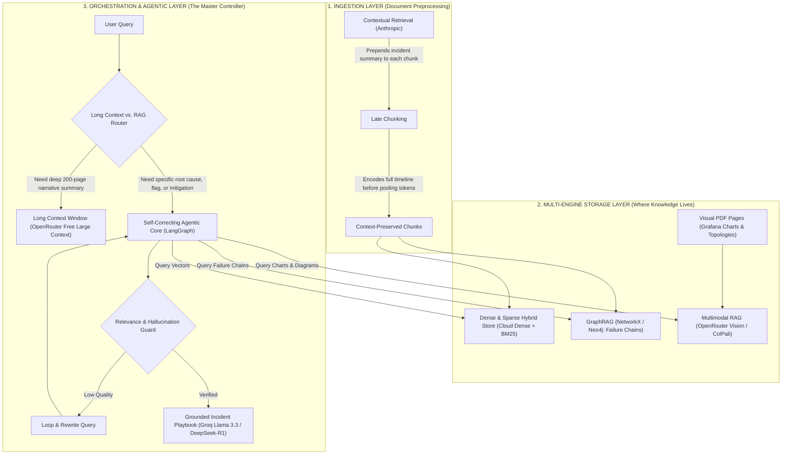

# 🏗️ 02 — Architecture Overview

> **Context:** This file explains how 6 advanced RAG techniques connect as layers in one unified engine.  
> **Prerequisite:** [01_problem_and_solution.md](./01_problem_and_solution.md)

---

## 2.1 The Unified Architecture: Agentic Modular RAG

These 6 advanced techniques are **not separate choices** — they operate as interconnected layers in a single, cohesive engine:

---

## 2.2 Layer-by-Layer Breakdown

| Layer | Technique | Exact Role in IncidentLens |
|---|---|---|
| **1. Ingestion** | **Contextual Retrieval (Anthropic)** | Injects a 50-word incident summary header to every chunk before embedding so the chunk never forgets which outage or system it belongs to. |
| **1. Ingestion** | **Late Chunking** | Encodes the entire 14-hour incident timeline at once, preserving long-range attention between the initial bug and the crash 6 hours later. |
| **2. Storage** | **GraphRAG (Multi-Hop)** | Indexes **cascading microservice relationships** (`DNS Route Leak` → `Kafka Queue Full` → `DB Starvation`) so the system can answer multi-hop dependency questions. |
| **2. Storage** | **Multimodal RAG (Cloud Vision)** | Reads visual PDF screenshots of **Grafana CPU/latency spikes and architecture flowcharts** using free cloud vision APIs. |
| **3. Execution** | **Self-Correcting Agentic RAG** | The **LangGraph Master Brain**: Coordinates retrieval, grades document relevance, rewrites poor queries, and checks for hallucinations before answering. |
| **4. Strategy** | **Long Context vs. RAG** | The **Dynamic Decision Engine**: Chooses *when* it is cheaper/faster to use targeted RAG vs. *when* to pass the full document directly into a 1M token cloud context window. |

---

## 2.3 Design Principles

1. **Layered Independence:** Each layer can be tested, upgraded, or replaced independently.
2. **Graceful Degradation:** If GraphRAG or vision is unavailable, the system falls back to hybrid text search.
3. **Zero Hallucination Tolerance:** Every answer passes a citation check before reaching the user.
4. **Cost-Zero Operations:** All models and tools are on free tiers — no credit card required.
5. **Observable by Default:** Every query is traced end-to-end via LangSmith/Langfuse.

---

## 🔗 Next

→ [03_tech_stack.md](./03_tech_stack.md) — Exact models, platforms, and free tiers.
