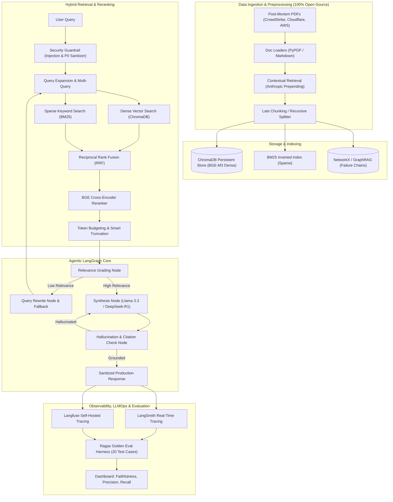
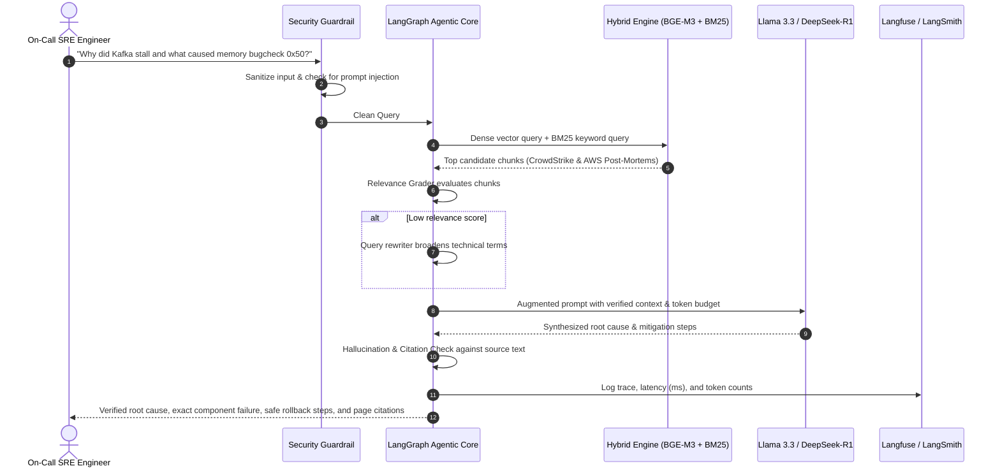

# 📐 04 — System Diagrams

> **Context:** Visual architecture and user-flow diagrams for the complete IncidentLens pipeline.  
> **Prerequisite:** [02_architecture_overview.md](./02_architecture_overview.md)

---

## 4.1 End-to-End Architectural Diagram



---

## 4.2 End-to-End User Flow (Sequence Diagram)



---

## 4.3 Data Flow Summary

```
PDF/MD Documents
    ↓
[Loaders] → [Contextual Prepending] → [Late Chunking]
    ↓                                       ↓
[ChromaDB Dense Index]              [BM25 Sparse Index]    [NetworkX Graph]
    ↓                                       ↓                     ↓
    └──────────── Reciprocal Rank Fusion ──────────────────────────┘
                            ↓
                  [Cross-Encoder Reranker]
                            ↓
                    [Token Budgeter]
                            ↓
                  [LangGraph Agent Loop]
                    ├── Relevance Grade
                    ├── Query Rewrite (if low)
                    ├── LLM Synthesis
                    └── Hallucination Check
                            ↓
                  [Grounded Response + Citations]
                            ↓
                  [LangSmith / Langfuse Trace]
```

---

## 🔗 Next

→ [05_directory_structure.md](./05_directory_structure.md) — Complete file and folder layout.
