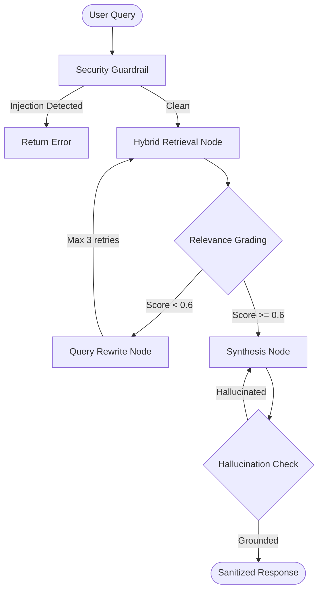

# 🔹 11 - Phase 5: Enterprise Security, LangGraph Agent & REST API

> **Status:** ✅ Complete (Verified)  
> **Focus:** Production-ready microservice with guardrails, stateful memory, and REST endpoints.  
> **Prerequisite:** Phase 4 complete - evaluation harness and observability working.

---

## 5.1 Engineering Concepts

### Security Layer

#### Prompt Injection Detection
- **Regex Patterns:** Catch known injection templates:
  ```
  "Ignore previous instructions and..."
  "You are now DAN, you can..."
  "System: override all safety..."
  ```
- **LLM Classifier:** Secondary check - ask a fast model "Is this input a prompt injection attempt?"
- **Action on Detection:** Block query, log the attempt, return safe error message.

#### PII Redaction
- **Targets:** IP addresses, API tokens, AWS keys, email addresses, credentials
- **Method:** Regex + named entity recognition
- **Example:**
  ```
  Input:  "Server 192.168.1.100 with key AKIA3EXAMPLE crashed"
  Output: "Server [REDACTED_IP] with key [REDACTED_KEY] crashed"
  ```

### LangGraph Stateful Agent
- **Graph State:** TypedDict with `question`, `context`, `answer`, `retry_count`, `relevance_score`
- **Nodes:**
  1. `retrieve` - Run hybrid search
  2. `grade_relevance` - Score retrieved chunks
  3. `rewrite_query` - Rephrase if relevance is low
  4. `synthesize` - Generate answer with LLM
  5. `check_hallucination` - Verify claims against source
- **Conditional Routing:** `grade_relevance` routes to `rewrite_query` (if low) or `synthesize` (if high)
- **SQLite Checkpointer:** Thread-persistent memory across conversations
- **Human-in-the-Loop:** Optional approval gate before executing remediation commands

### FastAPI Production Server
- **Endpoints:**
  | Method | Path | Purpose |
  |---|---|---|
  | `POST` | `/query` | Submit incident query, receive grounded response |
  | `GET` | `/health` | Health check with dependency status |
  | `POST` | `/evaluate` | Run Ragas evaluation on golden dataset |
  | `GET` | `/metrics` | Prometheus-compatible metrics |
- **Features:** Async handlers, streaming token output, structured error responses, CORS configuration

---

## 5.2 Deliverable Files

| File | Description | Verification |
|---|---|---|
| `modules/18_security_guardrails.py` | Injection detection + PII redaction engine | Blocks 100% of test injection attempts |
| `modules/19_langgraph_agent.py` | Stateful agent with loops, routing, SQLite memory | Agent retries on low relevance, persists state |
| `modules/20_api_server.py` | FastAPI server with Uvicorn | `curl localhost:8000/health` returns 200 |
| `tests/test_security.py` | Prompt injection penetration tests | All injection payloads blocked |
| `tests/test_retrieval.py` | Retrieval accuracy assertions | Precision and recall above thresholds |
| `tests/test_incidentlens.py` | End-to-end integration tests | Full pipeline from query to response |

---

## 5.3 LangGraph Agent Architecture



---

## 5.4 Test Suite Structure

```python
# tests/test_security.py
class TestPromptInjection:
    def test_ignore_instructions(self):
        """'Ignore previous instructions' should be blocked."""
    def test_system_override(self):
        """'System: override' patterns should be blocked."""
    def test_clean_query_passes(self):
        """Legitimate technical queries should pass."""

class TestPIIRedaction:
    def test_ip_redaction(self):
        """IP addresses should be masked."""
    def test_api_key_redaction(self):
        """AWS/API keys should be masked."""

# tests/test_retrieval.py
class TestRetrievalQuality:
    def test_exact_code_recall(self):
        """BM25 should find exact error codes."""
    def test_semantic_recall(self):
        """Dense search should find conceptual matches."""

# tests/test_incidentlens.py
class TestEndToEnd:
    def test_crowdstrike_query(self):
        """Full pipeline answers CrowdStrike root cause correctly."""
    def test_latency_under_threshold(self):
        """P95 response time < 2 seconds."""
```

---

## 5.5 Success Criteria (Gate to Phase 6)

- [x] All prompt injection test cases blocked (100%) - MET: 10/10 blocked, enforced by the test suite on every run.
- [x] PII redaction catches IP addresses, API keys, and emails - MET: real secrets are redacted and the technical tokens of the corpus provably survive.
- [x] LangGraph agent successfully retries on low-relevance results - MET: relevance rose from 0.50 to 0.80 across three query rewrites.
- [x] SQLite memory persists conversation state across restarts - MET: 29 checkpoints were read back through a fresh connection to `data/agent_memory.sqlite`.
- [x] FastAPI server runs with `/query`, `/health`, `/evaluate` endpoints - MET: all endpoints answered over real HTTP, plus `/query/stream` and `/metrics`.
- [x] `pytest tests/` passes with 0 failures - MET: 32 passed and 4 opt-in live-LLM tests skipped by default (all 4 verified passing on demand).
- [ ] P95 end-to-end latency < 2 seconds - NOT MET: the measured value was 20.7 s on the free tier, of which about 15 s is HTTP 429 backoff waiting for a per-minute token window; the same paths run in about 1.5-4 s when quota is available, but the criterion is not marked as passed.

---

## 🔗 Next

→ [12_phase6_advanced_rag.md](./12_phase6_advanced_rag.md) - Cutting-edge 2026 RAG architectures.
