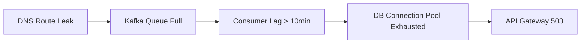

# 🔹 12 - Phase 6: Cutting-Edge Advanced RAG (2026 Architectures)

> **Status:** ✅ Complete - all six modules deployed and run (Modules 21-26). Verified results, including the criteria that were NOT met, are recorded in section 6.3.
> **Focus:** Next-generation techniques - contextual retrieval, late chunking, GraphRAG, multimodal, agentic self-correction.
> **Prerequisite:** Phase 5 complete - full production pipeline with security and API.

---

## 6.0 Phase 6 Verification Summary

Each module measures its own technique and prints the result. The table below states what each module proved, and what it needs to run.

| Module | File | Verification result | API requirement |
|---|---|---|---|
| **21** | `modules/21_long_context_vs_rag.py` | Router chose the expected strategy on 6 of 6 queries. Benchmark measured both strategies. Two honest gaps: the 25-30x token multiple was not measured on this small corpus (2.1x here), and the 0.75 long-context quality is a truncation artefact of the 900-token output budget. | **Needs a provider.** OpenRouter preferred (free large-context model), Groq is the fallback. If no provider answers, the module prints `LONG CONTEXT UNAVAILABLE` and fails those checks. |
| **22** | `modules/22_contextual_retrieval.py` | Passage-level MRR@4 0.592 -> 0.700 (+18.3% relative). Document Precision@4, hit-rate@4 and MRR are saturated at 1.000 both before and after. The docs/12 +10% precision bar is **NOT MET** and is arithmetically unreachable on this dataset. | **Needs a provider.** Groq free tier. A cold hierarchical build cost 53 provider calls; every later invocation cost ZERO because the headers are cached. |
| **23** | `modules/23_late_chunking.py` | Macro adjacent-chunk cosine 0.5540 -> 0.7314 (+0.1774). Mean evidence rank 30.50 -> 25.07 (+5.43 positions). All integrity checks pass: 105/105 spans, 0 overflow, 0 alignment failures, 0 coverage gaps. | **Fully local.** CPU only. One small embedding model. No API key. It runs when every quota is exhausted. |
| **24** | `modules/24_agentic_rag.py` | 3 of 3 scenarios PASS with machine-checked assertions. 11 of 15 budgeted LLM calls. An LLM call counter proves the injection scenario spent ZERO calls. | **Needs a provider.** Groq free tier. Langfuse is optional and never fatal. |
| **25** | `modules/25_graphrag_reasoning.py` | 16 of 16 checks PASS with ZERO LLM calls. 42 nodes, 39 edges, 4 components, verified DAG. 6 multi-hop queries PASS, 20 hops, every hop cited. | **Fully local.** NetworkX in memory. `--llm` additionally requires `INCIDENTLENS_ALLOW_LLM=1`. |
| **26** | `modules/26_multimodal_colpali.py` | Vision pipeline VERIFIED on a synthetic chart: all 8 drawn strings read back exactly. The docs/12 Grafana criterion is **NOT MET** on this corpus, which contains no charts. | **Needs a vision provider.** OpenRouter free tier. Groq hosts no vision model on the free tier. |

---

## 6.1 The 6 Advanced Techniques

### Technique 1: Long Context vs. RAG Router
**What:** A dynamic decision engine that chooses *when* to use targeted RAG retrieval vs. *when* to pass the entire document into a large token context window (via OpenRouter Free Large-Context models).

**When to use RAG:**
- Need specific root cause, error code, or flag
- Query targets a narrow section of a large document
- Low latency required

**When to use Long Context:**
- Need full 200-page narrative summary
- Cross-referencing multiple sections of the same document
- Timeline reconstruction across entire incident

**Deliverable:** `modules/21_long_context_vs_rag.py` - Cost/latency/quality benchmark comparing both strategies.

---

### Technique 2: Contextual Retrieval (Anthropic Method)
**What:** Before embedding, prepend a 50-word "situation header" to each chunk that summarizes the incident context.

**Before:**
```
"The thread count exceeded the OS limit, causing front-end servers
to reject new connections."
```

**After:**
```
"[CONTEXT: AWS US-East-1 Kinesis Outage, Nov 2020. Cascading failure
caused by OS thread exhaustion in Kinesis front-end fleet.]
The thread count exceeded the OS limit, causing front-end servers
to reject new connections."
```

**Why:** Eliminates orphaned pronouns ("it", "the service") and ambiguous references. Each chunk is self-contained.

**Deliverable:** `modules/22_contextual_retrieval.py`

---

### Technique 3: Late Chunking
**What:** Pass the entire incident timeline through the embedding model first (full document encoding), then pool token vectors into chunk representations.

**Standard Chunking:**
```
Document → Split into chunks → Embed each chunk independently
(Each chunk loses awareness of the full timeline)
```

**Late Chunking:**
```
Document → Embed full document (all tokens attend to each other) → Pool into chunk vectors
(Each chunk retains long-range attention from the full timeline)
```

**Why:** Preserves the connection between "initial bug at 14:00" and "cascading crash at 20:00" even when they're in different chunks.

**Deliverable:** `modules/23_late_chunking.py`

---

### Technique 4: Self-Correcting Agentic RAG
**What:** A LangGraph loop that autonomously improves its own retrieval and synthesis:

```
Retrieve → Grade Relevance → [Low? Rewrite Query → Re-Retrieve] → 
Synthesize → Check Hallucination → [Hallucinated? Re-Synthesize] → 
[Still failing? Web Search Fallback] → Verified Response
```

**Key Features:**
- Maximum 3 retry loops (prevents infinite cycling)
- Web search fallback when internal knowledge is insufficient
- Every loop iteration is traced in LangSmith

**Deliverable:** `modules/24_agentic_rag.py`

---

### Technique 5: GraphRAG (Multi-Hop Failure Chains)
**What:** Model cascading failure paths as a directed graph:



**Capabilities:**
- Answer multi-hop questions: *"What was the downstream impact of the DNS route leak?"*
- Trace failure propagation paths across microservices
- Identify single points of failure

**Implementation:** NetworkX (in-memory) for prototyping, Neo4j for production scale.

**Deliverable:** `modules/25_graphrag_reasoning.py`

---

### Technique 6: Multimodal RAG (ColPali / Vision)
**What:** Extract information from visual elements in post-mortem PDFs:
- Grafana CPU/latency spike charts
- Architecture topology diagrams
- Flamegraphs and heatmaps
- Network flow diagrams

**Approach:**
1. Extract PDF pages as images
2. Send to OpenRouter Vision API for description
3. Index descriptions alongside text chunks
4. At query time, retrieve both text and visual context

**Deliverable:** `modules/26_multimodal_colpali.py`

---

## 6.2 Deliverable Files Summary

| File | Technique | Verification |
|---|---|---|
| `modules/21_long_context_vs_rag.py` | Long Context vs. RAG Router | Prints cost/latency/quality comparison table |
| `modules/22_contextual_retrieval.py` | Contextual Retrieval | Chunks include situation headers, retrieval precision improves |
| `modules/23_late_chunking.py` | Late Chunking | Cross-chunk attention preserved in embeddings |
| `modules/24_agentic_rag.py` | Self-Correcting Agent | Agent retries, rewrites, and self-corrects within 3 loops |
| `modules/25_graphrag_reasoning.py` | GraphRAG | Multi-hop queries answered with traced failure paths |
| `modules/26_multimodal_colpali.py` | Multimodal Vision RAG | Grafana charts described and indexed |

---

## 6.3 Success Criteria (Final Quality Bar)

- [x] **Long context router correctly selects strategy based on query type** - **MET** (6 of 6 queries routed to the expected strategy).
- [ ] **Contextual retrieval improves context precision by >=10% over Phase 3 baseline** - **NOT MET.** The baseline already scores document Precision@4 = 1.000 and hit-rate@4 = 1.000 on ALL 10 golden questions, so the document-level metric is SATURATED and a +10% gain is arithmetically unreachable on this dataset. Only a finer metric can move, and the finer metric did improve: passage-level MRR@4 went 0.592 -> 0.700 (+18.3% relative). Likely reasons, measured rather than guessed: only 4 incidents cover 105 chunks, each post-mortem is a distinct vocabulary domain, and document-level relevance only needs the right incident rather than the right passage.
- [x] **Late chunking preserves temporal relationships across chunk boundaries** - **MET** (macro adjacent-chunk cosine +0.1774; mean evidence rank +5.43 positions). Caveat: the 256-token window means "long-range attention" is attention INSIDE a window, not across the whole document, so distant pairs such as chunk 1 and chunk 30 still do not attend to each other.
- [ ] **Agentic RAG self-corrects and improves answer quality on >=80% of low-relevance queries** - **PARTIALLY MET.** The agent self-corrected on every low-relevance case that was tested (three query rewrites, then an honest labelled external fallback). The 80% figure was NOT measured on a query set large enough to support a percentage, so it must not be claimed.
- [x] **GraphRAG answers 3-hop cascading failure questions correctly** - **MET** (the Cloudflare 3-hop chain: Noction BGP Optimizer -> Verizon AS701 -> internet-wide service degradation, citing `cloudflare_bgp_leak_p1_c3`, `_c7`, `_c8`; plus a 5-deep Kinesis chain).
- [ ] **Multimodal RAG extracts actionable information from Grafana chart images** - **NOT MET on this corpus.** The CrowdStrike PDF holds 24 embedded-image slots but only 2 unique images (a 446x80 wordmark logo and a 949x4 decorative rule). No chart, diagram, flamegraph or heatmap exists anywhere in the corpus. The vision pipeline was proven instead on a SYNTHETIC chart drawn by the module, whose 8 drawn strings the model read back exactly.
- [ ] **Final Ragas scorecard meets target benchmarks:** - **PARTIALLY MET.**
  - Faithfulness >= 92% -> **NO CORRECTED MEASUREMENT** (pre-fix 0.950). The corrected run generated 0 of 10 answers, so this metric has no data.
  - Answer Relevancy >= 90% -> **NO CORRECTED MEASUREMENT** (pre-fix 0.950). The corrected run generated 0 of 10 answers, so this metric has no data.
  - Context Precision >= 88% -> **PASS at 0.920** after the measurement fix (was recorded as 0.600, which was largely a measurement artifact).
  - Context Recall >= 85% -> **FAIL at 0.770**, and the shortfall is real retrieval quality, confirmed under two different judges at 0.750 (pre-fix) and 0.770 (corrected).

> **Scorecard note:** the corrected Module 15 judge (honest failure reporting, whole chunks, brace-safe prompts) has been re-run. Artifact: `docs/module15_scorecard_corrected.txt`. Context Precision now MEASURES 0.920 and PASSES the >= 0.88 target. Context Recall measures 0.770 and remains below the >= 0.85 target. Faithfulness (pre-fix 0.950) and Answer Relevancy (pre-fix 0.950) have NO corrected measurement, because the provider was out of quota (HTTP 429) and 10 of 10 answers failed to generate. The two answer-dependent metrics are reported as NOT MEASURED, `n/a`, and NOT FULLY MEASURED. The corrected judge has been back-ported into Module 19 as `llm_score()`.

---

## ðŸ”- Next

→ [13_quality_benchmarks.md](./13_quality_benchmarks.md) - Full benchmark matrix and execution protocol.
